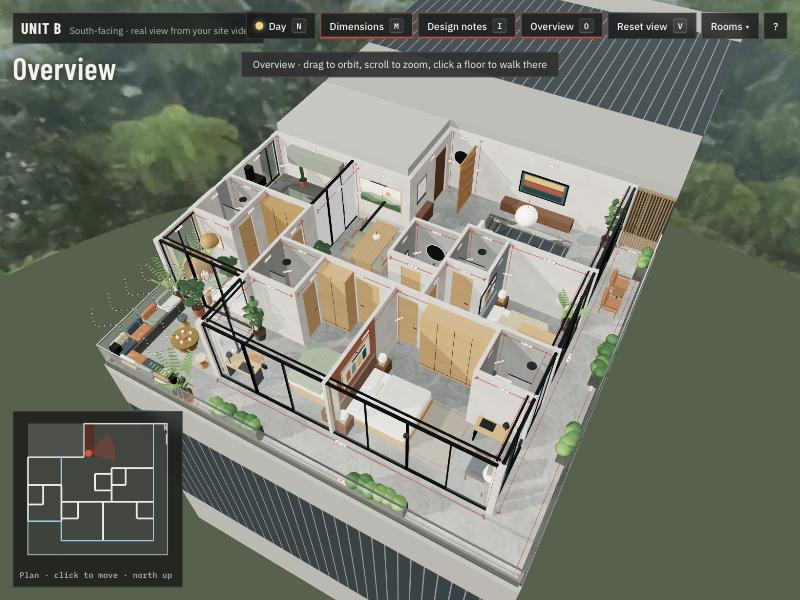

# Unit A & Unit B walkthroughs

Walk-through 3D models of two apartments from a 2nd–9th floor presentation plan. Both units are redesigned inside the original boundaries.

**Live site:** https://justanotherwanderer.github.io/apartment-walkthrough/

| | Unit A | Unit B |
|---|---|---|
| Faces | North, hill view | South, real view from the site video |
| Open | [Unit A walkthrough](https://justanotherwanderer.github.io/apartment-walkthrough/Unit_A_North_Hill_View.html) | [Unit B walkthrough](https://justanotherwanderer.github.io/apartment-walkthrough/Unit_B_South_Real_View.html) |

## What's in each flat

- Four bedrooms, each with an attached bath, plus a guest powder room
- An L-shaped, 5'-0" deep balcony that every bedroom and the living room open onto, ending in a 12' × 12' adda square
- Full-height glass sliders and windows that are as large as possible
- A sunken lounge (1'-6" drop, 11'-0" clear over the seating)
- Plain cement floors, textured grey walls with one accent wall per room, and a boho bedroom
- 9'-6" ceilings, with every wall dimensioned in feet

## Controls

| Key | Action |
|---|---|
| ↑ ↓ / W S | Walk forward / back |
| ← → | Turn |
| A D | Step sideways (Shift to hurry) |
| Drag | Look around |
| V | Back to eye level (5'-4"), looking straight ahead |
| Click / E | Open doors, slide glass, draw curtains |
| C | All curtains in the room |
| N | Day / night (all lights on) |
| M | Dimension lines |
| I | Design notes |
| O | Cut-away overview |

## Notes

- Unit B's south and west views are stitched from a site video. The east side comes from the other end of the same floor. Unit A's hill view is generated.
- Unit sizes are read from a photo of the plan: about 50'-0" × 47'-0" per unit, minus the stair and lift core.
- Each page is a single self-contained HTML file. three.js loads from jsDelivr, so an internet connection is needed.
